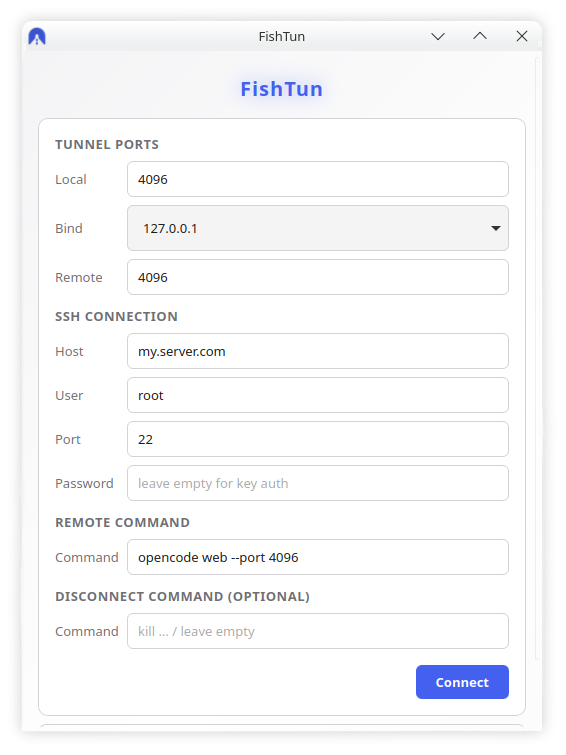

[](https://go.dev)
[](LICENSE)
[](https://wails.io)

<p align="center"></p>
<p><h1 style="margin:0;padding:0;text-align:center;">FishTun</h1></p>
<p align="center"><i>Native GUI app — multi-tunnel SSH port forwarding</i></p>
<p align="center">🇬🇧 English | 🇷🇺 <a href="README_ru.md">Русский</a></p>

## Overview

FishTun is a desktop application built with Go, Wails, and Vue 3 that lets you create and manage multiple SSH tunnels through a native GUI. It forwards a remote port to your local machine and can optionally execute a command on the remote host (start/stop hooks).

<p align="center"></p>

## Features

- 🔐 SSH tunnel via `golang.org/x/crypto/ssh` (no shelling out to `ssh`)
- 📡 Multiple tunnels simultaneously
- 🔄 Keepalive (30s interval), auto-disconnect on failure
- 🖥️ Native GUI (Wails v2 WebView + Vue 3)
- 🔑 Auth: key-based (id_rsa) + password fallback (GUI or terminal prompt)
- 💾 Saved hosts: store, edit and reconnect with one click (`~/.config/FishTun/hosts`)
- ⚙️ Config persistence in `~/.config/FishTun/config`
- 🪟 System tray: show window, disconnect all, make more tunnels, quit
- 🌗 Light/dark theme (follows system preference)
- ▶️ Remote command execution on connect (e.g. start your app)
- ⏹️ Disconnect hook on tunnel teardown
- 🌐 Open tunnel URL in the OS browser (`xdg-open` / `open` / `rundll32`)
- 🧷 Single instance: a second launch focuses the running window instead of starting a new process
- 📜 In-app console log with full-window expand

## Requirements

- Go 1.25+
- CGO enabled
- Linux dev headers: GTK3, WebKit2GTK 4.1, X11
- Wails CLI v2

```bash
sudo apt install gcc libx11-dev libxrandr-dev libxinerama-dev libxi-dev \
  libgl1-mesa-dev libxxf86vm-dev libgtk-3-dev libwebkit2gtk-4.1-dev

go install github.com/wailsapp/wails/v2/cmd/wails@latest
```

## Quick Start

```bash
git clone https://github.com/alexoffspace/FishTun.git
cd FishTun
wails build -tags webkit2_41
./build/bin/FishTun
```

## Configuration

Stored in `~/.config/FishTun` (`%USERPROFILE%\.config\FishTun` on Windows).

### `config` — last used connection

Saved automatically, pre-fills the form on the next run:

```
LOCAL_PORT="2222"
REMOTE_PORT="8080"
SSH_HOST="my.server.com"
SSH_USER="root"
SSH_PORT="22"
LOCAL_HOST="127.0.0.1"
REMOTE_CMD="nohup myapp --port 8080 &"
DISCONNECT_CMD="pkill -f myapp"
```

Fields are editable from the GUI. The config persists between runs.

### `hosts` — saved hosts (INI)

Written when you save a host from the form; passwords are never persisted.

```ini
[myapp]
LOCAL_PORT="2222"
REMOTE_PORT="8080"
SSH_HOST="my.server.com"
SSH_USER="root"
SSH_PORT="22"
LOCAL_HOST="127.0.0.1"
REMOTE_CMD="nohup myapp --port 8080 &"
DISCONNECT_CMD="pkill -f myapp"
```

Values are escaped (`\\`, `\"`, `\n`), so multi-line commands are safe.

## Project Structure

| File | Purpose |
|---|---|
| `main.go` | Wails app entry, window options, icon selection (ICO on Windows, PNG elsewhere) |
| `app.go` | Go ↔ frontend bridge: Connect, Disconnect, OpenBrowser, hosts CRUD, config, event emit |
| `ssh.go` | Tunnel core: SSH dial, TCP listener, connection relay, remote command, keepalive |
| `config.go` | Config load/save (`~/.config/FishTun/config`) and saved hosts (`~/.config/FishTun/hosts`) |
| `instance.go` | Single-instance lock file + loopback IPC ("show" → focus running window) |
| `tunnel.go` | Helpers: `openURL`, `waitForLocalPort` |
| `systray.go` | System tray menu and event pipes |
| `genico.go` | Regenerates `icon.ico` from `icon.png` (run after changing the icon) |
| `frontend/` | Vue 3 + TypeScript UI (`App.vue`, `Form.vue`, `HostsView.vue`, `TunnelsView.vue`, `LogView.vue`) |

## Architecture

1. **GUI** (Wails + Vue 3) — user enters SSH params, sees connection status, log and tunnel list
2. **SSH tunnel** — `ssh.Dial` with key-based + password auth; local TCP listener forwards to remote via `sshClient.Dial`
3. **Remote command** — optional command executed via SSH session on connect; optional disconnect hook on teardown
4. **Keepalive** — `keepalive@openssh.com` every 30s; auto-disconnects on failure
5. **Browser** — tunnel URL opened via `xdg-open` / `open` / `rundll32`
6. **System tray** — background operation, quick disconnect, quit
7. **Events** — Go bridge emits `log`/`status`/`error`/`tunnels` events; Vue listens via `EventsOn`
8. **Single instance** — `O_EXCL` lock file holding a loopback IPC port; a second launch sends `show` and exits. Stale locks from a crash are recovered by removing the file and retrying.
9. **Close behavior** — the X button shows an in-app popup (System tray / Close app) instead of terminating, so tunnels keep running in the tray

## Icons

`icon.png` is the single source of truth. Windows needs an ICO container:

```bash
go run genico.go   # regenerates icon.ico (and build/windows/icon.ico)
```

## Release

1. Bump `info.productVersion` in `wails.json`
2. Commit, tag, push:

```bash
git add -A && git commit -m "chore: release vX.Y.Z"
git tag vX.Y.Z
git push origin vX.Y.Z
```

3. GitHub Actions builds 6 variants (linux amd64/arm64 `.tar.gz`, macos amd64/arm64 `.dmg`, windows amd64/arm64 `.exe`) and publishes a Release with auto-generated notes.

## License

MIT © 2026 Alexey Belov
