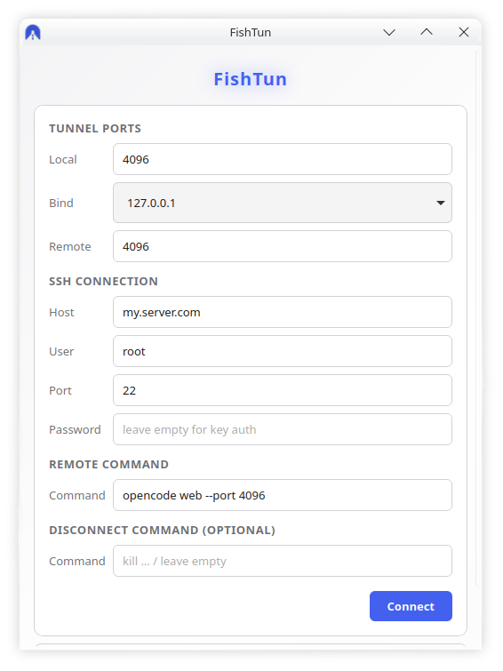

[](https://go.dev)
[](LICENSE)
[](https://wails.io)

<p align="center"></p>
<p><h1 style="margin:0;padding:0;text-align:center;">FishTun</h1></p>
<p align="center"><i>Нативное GUI-приложение — множество SSH-туннелей для проброса портов</i></p>
<p align="center">🇬🇧 <a href="README.md">English</a> | 🇷🇺 Русский</p>

## Обзор

FishTun — десктопное приложение на Go, Wails и Vue 3, позволяющее создавать и управлять несколькими SSH-туннелями через нативный GUI. Оно пробрасывает удалённый порт на локальную машину и по желанию выполняет команду на удалённом хосте (хуки запуска/остановки).

<p align="center"></p>

## Возможности

- 🔐 SSH-туннель через `golang.org/x/crypto/ssh` (без вызова внешнего `ssh`)
- 📡 Несколько туннелей одновременно
- 🔄 Keepalive (интервал 30 с), авто-отключение при сбое
- 🖥️ Нативный GUI (Wails v2 WebView + Vue 3)
- 🔑 Аутентификация: по ключу (id_rsa) + fallback на пароль (в GUI или из терминала)
- 💾 Сохранённые хосты: сохранение, редактирование и переподключение одним кликом (`~/.config/FishTun/hosts`)
- ⚙️ Персистентность конфига в `~/.config/FishTun/config`
- 🪟 Системный трей: показать окно, отключить все, создать ещё туннели, выход
- 🌗 Светлая/тёмная тема (по системным настройкам)
- ▶️ Выполнение команды на удалённом хосте при подключении (например, запуск приложения)
- ⏹️ Хук отключения при разрыве туннеля
- 🌐 Открытие URL туннеля в системном браузере (`xdg-open` / `open` / `rundll32`)
- 🧷 Один экземпляр: повторный запуск фокусирует уже работающее окно вместо нового процесса
- 📜 Встроенный лог консоли с разворотом на всё окно

## Требования

- Go 1.25+
- Включённый CGO
- Linux dev-заголовки: GTK3, WebKit2GTK 4.1, X11
- Wails CLI v2

```bash
sudo apt install gcc libx11-dev libxrandr-dev libxinerama-dev libxi-dev \
  libgl1-mesa-dev libxxf86vm-dev libgtk-3-dev libwebkit2gtk-4.1-dev

go install github.com/wailsapp/wails/v2/cmd/wails@latest
```

## Быстрый старт

```bash
git clone https://github.com/alexoffspace/FishTun.git
cd FishTun
wails build -tags webkit2_41
./build/bin/FishTun
```

## Конфигурация

Хранится в `~/.config/FishTun` (в Windows — `%USERPROFILE%\.config\FishTun`).

### `config` — последнее использованное подключение

Сохраняется автоматически и предзаполняет форму при следующем запуске:

```
LOCAL_PORT="2222"
REMOTE_PORT="8080"
SSH_HOST="my.server.com"
SSH_USER="root"
SSH_PORT="22"
LOCAL_HOST="127.0.0.1"
REMOTE_CMD="nohup myapp --port 8080 &"
DISCONNECT_CMD="pkill -f myapp"
```

Поля редактируются в GUI. Конфиг сохраняется между запусками.

### `hosts` — сохранённые хосты (INI)

Записывается при сохранении хоста из формы; пароли не сохраняются никогда.

```ini
[myapp]
LOCAL_PORT="2222"
REMOTE_PORT="8080"
SSH_HOST="my.server.com"
SSH_USER="root"
SSH_PORT="22"
LOCAL_HOST="127.0.0.1"
REMOTE_CMD="nohup myapp --port 8080 &"
DISCONNECT_CMD="pkill -f myapp"
```

Значения экранируются (`\\`, `\"`, `\n`), поэтому многострочные команды безопасны.

## Структура проекта

| Файл | Назначение |
|---|---|
| `main.go` | Точка входа Wails-приложения, параметры окна, выбор иконки (ICO в Windows, PNG в остальных) |
| `app.go` | Мост Go ↔ фронтенд: Connect, Disconnect, OpenBrowser, CRUD хостов, конфиг, отправка событий |
| `ssh.go` | Ядро туннеля: SSH dial, TCP-листенер, релей соединений, удалённая команда, keepalive |
| `config.go` | Загрузка/сохранение конфига (`~/.config/FishTun/config`) и сохранённых хостов (`~/.config/FishTun/hosts`) |
| `instance.go` | Lock-файл единственного экземпляра + loopback IPC («show» → фокус работающего окна) |
| `tunnel.go` | Хелперы: `openURL`, `waitForLocalPort` |
| `systray.go` | Меню системного трея и каналы событий |
| `genico.go` | Пересоздаёт `icon.ico` из `icon.png` (запускать после смены иконки) |
| `frontend/` | UI на Vue 3 + TypeScript (`App.vue`, `Form.vue`, `HostsView.vue`, `TunnelsView.vue`, `LogView.vue`) |

## Архитектура

1. **GUI** (Wails + Vue 3) — пользователь вводит SSH-параметры, видит статус подключения, лог и список туннелей
2. **SSH-туннель** — `ssh.Dial` с аутентификацией по ключу + паролю; локальный TCP-листенер пробрасывает трафик на удалённую сторону через `sshClient.Dial`
3. **Удалённая команда** — опциональная команда, выполняемая через SSH-сессию при подключении; опциональный хук отключения при teardown
4. **Keepalive** — `keepalive@openssh.com` каждые 30 с; авто-отключение при сбое
5. **Браузер** — URL туннеля открывается через `xdg-open` / `open` / `rundll32`
6. **Системный трей** — работа в фоне, быстрое отключение, выход
7. **События** — Go-мост отправляет события `log`/`status`/`error`/`tunnels`; Vue слушает через `EventsOn`
8. **Единственный экземпляр** — lock-файл через `O_EXCL` хранит порт loopback IPC; повторный запуск отправляет `show` и завершается. Устаревшие локи после падения восстанавливаются удалением файла и повтором.
9. **Поведение при закрытии** — кнопка X показывает встроенный попап (Системный трей / Закрыть приложение) вместо завершения, чтобы туннели продолжали работать в трее

## Иконки

`icon.png` — единственный источник истины. Windows требует ICO-контейнер:

```bash
go run genico.go   # пересоздаёт icon.ico (и build/windows/icon.ico)
```

## Релиз

1. Поднять `info.productVersion` в `wails.json`
2. Закоммитить, поставить тег, запушить:

```bash
git add -A && git commit -m "chore: release vX.Y.Z"
git tag vX.Y.Z
git push origin vX.Y.Z
```

3. GitHub Actions собирает 6 вариантов (linux amd64/arm64 `.tar.gz`, macos amd64/arm64 `.dmg`, windows amd64/arm64 `.exe`) и публикует Release с авто-сгенерированными заметками.

## Лицензия

MIT © 2026 Alexey Belov
